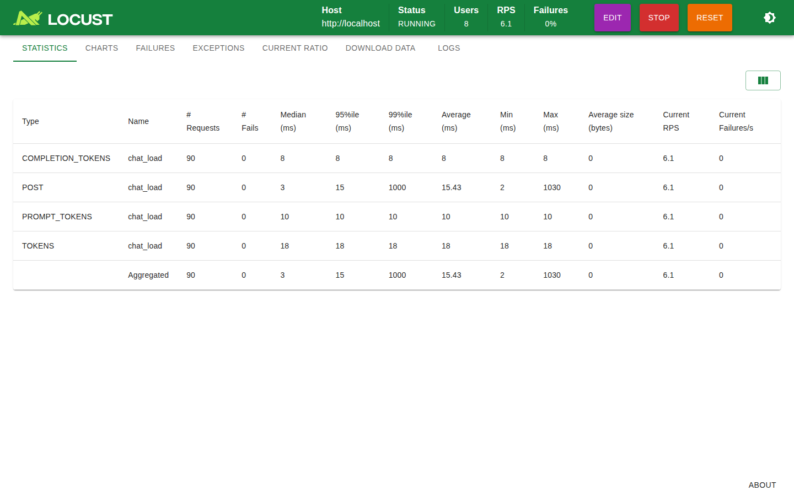

# llm-perf

Production-style, multi-layer performance testing framework for AI/LLM
applications built on **Locust** + **OpenTelemetry**.

Test LLM systems at multiple layers from declarative YAML configs — pick the
layers you care about and run them independently or together:

| Layer | What it tests | Key metrics |
|---|---|---|
| `llm_api` | Direct vendor calls — OpenAI, Anthropic, Azure OpenAI, AWS Bedrock, generic HTTP, gRPC | e2e latency, TTFT, tokens/sec, prompt/completion tokens, cost, error rate |
| `pipeline` | Declarative RAG / agent pipelines — retrieve → rerank → generate, tool-calling agent loops | e2e + per-stage latency, context recall, agent steps, token/cost rollup |
| `app_endpoint` | Your deployed app over HTTP or gRPC (black-box) | latency, error rate, OTel trace correlation |
| `app_object` | Your LangChain / LlamaIndex / Python object in-process | latency, output quality |

Plus: dataset-driven prompts, hybrid quality scoring (heuristics + LLM-as-judge
+ RAG recall), SLO thresholds with pass/fail gating and webhook alerts, OTel
traces/metrics, end-of-run CSV/JSON/HTML reports, and a Grafana dashboard.

## Install

```bash
python -m venv .venv && source .venv/bin/activate
pip install -e ".[dev]"
# optional extras:
# pip install -e ".[langchain,llamaindex,s3,gcs]"
```

Requires Python 3.10+.

## Quick start

```bash
cp .env.example .env   # fill in API keys (OPENAI_API_KEY, etc.)

# validate a config
llm-perf validate -c configs/openai_example.yaml

# run headless for 2 minutes with 10 users
llm-perf run -c configs/openai_example.yaml --headless -u 10 -t 2m

# or use the standard locust CLI directly (web UI on :8089)
LLM_PERF_CONFIG=configs/openai_example.yaml locust -f locustfile.py
```

Reports land in `report.output_dir` (CSV/JSON/HTML). Threshold failures exit
non-zero for CI (`thresholds.on_fail: fail`).

## The four layers

Each target in `targets:` has a `layer:` field. Layers are fully independent —
a config can contain any mix, and `scenarios[]` bind targets with weights.

### 1. `llm_api` — direct vendor API calls

Measures raw provider performance: time-to-first-token on streams, decode
throughput (tokens/sec), token accounting, and dollar cost.

```yaml
targets:
  - name: openai_chat
    layer: llm_api
    provider: openai            # openai | anthropic | azure | bedrock | http | grpc
    base_url: https://api.openai.com/v1   # optional; sensible defaults per provider
    api_key_env: OPENAI_API_KEY           # env var holding the key (never put keys in YAML)
    stream: true                          # true => TTFT + tokens/sec are measured
    params:
      model: gpt-4o-mini
      max_tokens: 512
      temperature: 0.7
    prompts: ["Explain {topic} in one paragraph", "Summarize: {text}"]
    vars:                                 # pools for {var} templating
      topic: ["transformers", "databases", "kubernetes"]
```

Or drive it from a dataset instead of inline prompts:

```yaml
datasets:
  prompts_ds:
    source: datasets/qa_pairs.jsonl
    format: jsonl
    columns: { prompt: question, expected: expected_answer }

targets:
  - name: openai_ds
    layer: llm_api
    provider: openai
    params: { model: gpt-4o-mini }
    dataset: prompts_ds                  # rows supply `prompt` (and expected/context for quality)
```

Supported providers and what they need:

| provider | credentials | notes |
|---|---|---|
| `openai` | `OPENAI_API_KEY` | chat completions; `stream_options.include_usage` for stream token counts |
| `anthropic` | `ANTHROPIC_API_KEY` | messages API; usage merged across SSE events |
| `azure` | `AZURE_OPENAI_API_KEY` + `base_url` | deployment name via `params.model` |
| `bedrock` | AWS credential chain | boto3 runtime client, Converse API |
| `http` | optional `api_key_env` | any OpenAI-ish JSON endpoint |
| `grpc` | — | `grpc.proto_path` + `method`/`request_template`, see below |

### 2. `pipeline` — declarative RAG / agent pipelines

Multi-stage pipelines where each stage is a config block. Stage types:
`retrieve`, `rerank`, `generate`, `agent`.

```yaml
datasets:
  qa:
    source: datasets/qa_pairs.jsonl
    format: jsonl
    columns: { prompt: question, expected: expected_answer, context: expected_context }

targets:
  - name: rag
    layer: pipeline
    dataset: qa
    pipeline:
      - stage: retrieve
        vector_store: { type: json, path: datasets/docs.jsonl }   # or http / chroma
        top_k: 3
      - stage: rerank
        method: llm
        llm: { provider: openai, model: gpt-4o-mini, api_key_env: OPENAI_API_KEY }
      - stage: generate
        template: prompts/rag_answer.j2
        llm:
          provider: openai
          model: gpt-4o-mini
          api_key_env: OPENAI_API_KEY
          params: { max_tokens: 512, temperature: 0.2 }
```

Every stage emits its own OTel span and `llm_perf_stage_duration` metric, so
thresholds can gate per-stage SLOs (`stages: { retrieve: { p95_ms: 2000 } }`).

**Agent stage** — an OpenAI-compatible tool-calling loop. The model emits
`tool_calls`, the engine executes them and feeds results back, up to
`max_iterations`. Three tool types are supported:

```yaml
- stage: agent
  max_iterations: 6
  llm: { provider: openai, model: gpt-4o, api_key_env: OPENAI_API_KEY }
  tools:
    - name: search_docs
      type: http                        # POST args.input to an external API
      url: http://localhost:8080/search
      method: POST
      api_key_env: SEARCH_API_KEY
    - name: get_order_status
      type: function                    # import path "module:callable", args as kwargs
      import_path: "example_tools.orders:get_status"
    - name: company_kb
      type: retrieve                    # vector-store lookup (same config as retrieve stage)
      vector_store: { type: json, path: datasets/docs.jsonl }
      top_k: 3
```

See `configs/agent_example.yaml` for a complete runnable example and
`configs/rag_example.yaml` for the RAG variant.

### 3. `app_endpoint` — black-box HTTP/gRPC app

Point at your deployed service. The layer sends templated requests and
measures pure transport latency/error rate — use it to test the app *around*
the model (auth, orchestration, guardrails).

```yaml
targets:
  - name: chat_api
    layer: app_endpoint
    transport: http                    # or grpc
    base_url: https://api.example.com
    endpoint: /v1/chat                 # appended to base_url
    method: POST
    headers: { Authorization: "Bearer ${APP_TOKEN}" }
    request_template: prompts/chat_request.json   # JSON template, {prompt} substituted
    dataset: prompts_ds
```

For gRPC set `transport: grpc`, `grpc.proto_path`, `grpc.method`, and
`grpc.request_template` (field mapping is best-effort; see
`protos/inference.proto` for the bundled minimal Triton-style proto).

### 4. `app_object` — in-process framework objects

Load your LangChain/LlamaIndex/custom Python object and invoke it per request —
no HTTP hop, so you measure the framework itself.

```yaml
targets:
  - name: my_chain
    layer: app_object
    framework: langchain               # langchain | llamaindex | generic
    python_path: "my_app.chains:build_chain"   # module.path:factory_fn
    call: ainvoke                      # ainvoke | invoke | query | aquery
    init_args: { model: gpt-4o-mini }
    dataset: prompts_ds
```

Requires the framework installed (`pip install -e ".[langchain]"` etc.).

## Running layers independently

A single config can hold all four layers; select what runs at invocation time:

```bash
# only the direct-API targets
llm-perf run -c configs/full_stack.yaml --layers llm_api --headless -u 20 -t 10m

# only the pipeline targets
llm-perf run -c configs/full_stack.yaml --layers pipeline --headless

# a single named scenario (fine-grained)
llm-perf run -c configs/full_stack.yaml --scenarios rag_load --headless
```

`--layers` accepts a comma list: `--layers llm_api,app_endpoint`. Filters apply
to `targets` and the `scenarios` that reference them; if nothing remains the
CLI exits with an error. You can also keep separate config files per layer —
`configs/openai_example.yaml`, `configs/rag_example.yaml`,
`configs/agent_example.yaml`, `configs/grpc_example.yaml` are standalone.

## Quality scoring

Per scenario, `quality:` combines three signals (all optional, all reported
alongside performance metrics):

- **heuristics** (free, every request): `non_empty`, `min_chars`/`max_chars`,
  `required_patterns`/`forbidden_patterns` (regex), `json_valid`, `contains`,
  `exact_match_field` (compare vs a dataset column), refusal detection.
- **judge** (LLM-as-judge, cost-controlled via `sample_rate`): sends
  prompt+response+rubric to any configured provider; JSON score normalized to
  0..1.
- **rag**: `context_recall` — overlap between retrieved context and dataset
  `expected_context`.

```yaml
scenarios:
  - name: chat_load
    target: openai_chat
    quality:
      sample_rate: 0.3
      heuristics: { non_empty: true, min_chars: 10,
                    forbidden_patterns: ["I cannot help with that"] }
      judge:
        provider: openai
        model: gpt-4o
        rubric: "Score 1-5 on correctness and helpfulness"
        scale: [1, 5]
      rag: {}
```

## Datasets

Prompt/test-data management:

```bash
llm-perf dataset list -c configs/openai_example.yaml
llm-perf dataset show qa_pairs -c configs/openai_example.yaml
llm-perf dataset sample qa_pairs -c configs/openai_example.yaml -n 5
llm-perf dataset import --from traces.jsonl --to datasets/imported.jsonl
llm-perf dataset validate datasets/qa_pairs.jsonl
```

Formats: `yaml`, `csv`, `jsonl`; sources: local path, `http(s)://`, `s3://`,
`gs://`. `sample:` supports `random`/`first`/`shuffle` with `count` + `seed`.
`{var}` placeholders in prompts are filled from `vars:` pools or row fields.

Import production traces: `--trace-format langsmith|langfuse` or generic JSONL
with `--map prompt=inputs.question,expected=outputs.answer`.

## Thresholds & alerts

```yaml
thresholds:
  global: { max_error_rate: 0.01, min_throughput_rps: 5 }
  scenarios:
    chat_load:
      p95_ms: 8000
      ttft_p95_ms: 1500
      min_quality_score: 0.7
      min_context_recall: 0.5
      stages: { retrieve: { p95_ms: 300 }, generate: { p95_ms: 40000 } }
  on_fail: fail           # or warn
  alerts:
    - type: slack
      url_env: SLACK_WEBHOOK_URL
      on: [threshold_breach, test_complete]
    - type: pagerduty
      url_env: PAGERDUTY_ROUTING_KEY
      on: [threshold_breach]
    - type: webhook
      url_env: HOOK_URL
      on: [test_complete]
```

Metrics you can gate on: `p50/p90/p95/p99_ms`, `ttft_p95_ms`,
`max_error_rate`, `min_throughput_rps`, `min_quality_score`,
`min_quality_pass_rate`, `min_context_recall`, `max_cost_usd`, and per-`stage`
latency rules. Threshold state is exported live as `llm_perf_threshold_pass`
gauges for Grafana/Alertmanager mid-run alerting; `on_fail: fail` makes the
CLI exit non-zero.

## Observability

All telemetry is **OpenTelemetry** — traces (per-request spans plus per-stage
spans for pipelines, GenAI semantic-convention attributes) and metrics
(`llm_perf.*` instruments). Export is OTLP/gRPC to any collector:

```bash
docker compose up -d     # otel-collector + prometheus + jaeger + grafana
# Grafana: http://localhost:3000  (provisioned "llm-perf" dashboard)
# Jaeger:  http://localhost:16686
# Prometheus: http://localhost:9090
```

Point `observability.otel.endpoint` at any OTLP backend (default
`http://localhost:4317`); set `enabled: false` to run without telemetry.
`otel-collector-config.yaml` ships a working pipeline: OTLP in →
Prometheus exporter + Jaeger exporter.

## Dashboards, metrics & UI

Everything you need at a glance while a run is live or after it finishes:

| UI | URL | Shows |
|---|---|---|
| Locust web UI | http://localhost:8089 | live RPS, latency percentiles, failures, per-scenario custom stats (TTFT, tokens, quality) |
| Grafana | http://localhost:3000 | provisioned **llm-perf** dashboard — OTel metrics: request rate, TTFT, tokens/sec, stage latency, quality, cost, threshold gauges |
| Prometheus | http://localhost:9090 | raw `llm_perf_*` metrics scraped from the collector |
| Jaeger | http://localhost:16686 | distributed traces — one trace per request with per-stage spans |

Live Locust UI during a run (screenshot taken against the bundled mock server —
regenerate with `python scripts/screenshot_dashboard.py`):



### Metrics catalog

**Locust request stats** (per scenario, shown in the UI and CSV/JSON reports):

| Stat | Meaning |
|---|---|
| `POST` / scenario name | request count, failures, RPS, avg + p50/p90/p95/p99 latency |
| `TTFT` | time-to-first-token in ms (streaming targets) |
| `TOKENS` / `PROMPT_TOKENS` / `COMPLETION_TOKENS` | token counts |
| `TOKENS_PER_SEC` | decode throughput (×100 scaling) |
| `QUALITY_SCORE` | quality score ×1000 (0–1000) |
| `CONTEXT_RECALL` | RAG context recall ×1000 |

**OTel metrics** (exported via OTLP → Prometheus/Grafana):

| Instrument | Type | Attributes |
|---|---|---|
| `llm_perf.request.duration` | histogram (s) | scenario, provider |
| `llm_perf.request.total` | counter | scenario, provider, result |
| `llm_perf.ttft` | histogram (s) | scenario, provider |
| `llm_perf.tokens` | counter | scenario, kind=input/output |
| `llm_perf.tokens_per_second` | gauge | scenario, provider |
| `llm_perf.users` | up-down counter | — |
| `llm_perf.stage.duration` | histogram (s) | scenario, stage |
| `llm_perf.quality.score` / `quality.pass` | histogram / counter | scenario, check |
| `llm_perf.rag.context_recall` | histogram | scenario |
| `llm_perf.cost.USD` | counter | scenario |
| `llm_perf.threshold.pass` | gauge (0/1) | rule — live SLO state for alerting |

**Traces**: one root span per request (`llm_perf.request`) plus child spans per
pipeline stage (`retrieve`, `rerank`, `generate`, `agent_step`, `agent_tool`)
with GenAI semantic-convention attributes (`gen_ai.usage.*`, model, finish
reason).

## Reports

End-of-run reports in `report.output_dir`:

- **CSV** — per-scenario stats (requests, failures, percentiles, TTFT,
  tokens/sec, tokens, cost, quality score/pass rate, context recall).
- **JSON** — machine-readable aggregate for CI/regression tracking.
- **HTML** — human-readable summary with threshold verdicts.

```yaml
report:
  formats: [csv, json, html]
  output_dir: results/openai
  percentiles: [50, 90, 95, 99]
  pricing: { input_per_1k: 0.15, output_per_1k: 0.60 }   # USD per 1K tokens -> cost metrics
```

## gRPC & proto workflow

1. Put your `.proto` somewhere reachable, e.g. `protos/my_service.proto`.
2. Pre-compile stubs: `llm-perf proto-gen -p protos/my_service.proto`
   (uses `grpc_tools.protoc`; `grpcio-tools` is a core dependency).
3. Reference it in the target:

```yaml
targets:
  - name: triton
    layer: llm_api
    provider: grpc
    grpc:
      proto_path: protos/inference.proto
      method: "inference.GRPCInferenceService/ModelInfer"
      request_template: prompts/triton_request.json
```

`protos/inference.proto` is a minimal Triton/KServe-style
`ModelInfer`/`ModelStreamInfer` definition you can copy for NVIDIA Triton or
KServe deployments. Field mapping in `request_template` is best-effort —
adjust to your service's schema.

## CI usage

```yaml
# .github/workflows/perf.yml
- run: pip install -e ".[dev]"
- run: llm-perf validate -c configs/openai_example.yaml --skip-connectivity
- run: llm-perf run -c configs/openai_example.yaml --headless -u 10 -t 5m
```

`thresholds.on_fail: fail` → non-zero exit on SLO breach. The repo's own CI
(`.github/workflows/ci.yml`) runs ruff, black, config validation, and pytest.

## Project layout

```
locustfile.py      # root shim so `locust -f locustfile.py` works
llm_perf/
  locustfile.py     # package entry (imported by root locustfile.py shim)
  config.py        # pydantic config schema (targets/scenarios/datasets/load/...)
  cli.py           # typer CLI (run/validate/proto-gen/quality-check/dataset)
  locustfile.py    # locust entry (generated users + lifecycle hooks)
  scenarios.py     # weighted User/TaskSet generation
  tasks.py         # per-request pipeline + quality hook
  metrics.py       # OTel instruments + Locust stats bridge
  otel/            # tracer/meter setup, GenAI semconv
  providers/       # openai, azure, anthropic, bedrock, http, grpc adapters
  transports/      # http + grpc for app_endpoint layer
  layers/          # llm_api, pipeline, app_endpoint, app_object
  pipelines/       # declarative stage engine (retrieve/rerank/generate/agent)
  adapters/        # langchain/llamaindex helpers
  quality/         # heuristics, judge, rag recall, scorer
  datasets.py      # dataset loaders/samplers/trace import
  prompts.py       # prompt pools + {var} templating
  thresholds.py    # SLO evaluation + webhooks
  reporters.py     # CSV/JSON/HTML reports
  templates/       # HTML report template
```

## Development

```bash
pip install -e ".[dev]"
ruff check llm_perf tests
black --check llm_perf tests
pytest -q          # 56 tests incl. a real Locust e2e run vs a mock server
```

## Notes & limitations (v0.1)

- The `agent` stage supports OpenAI/Azure-compatible tool calling; other
  providers raise a clear `NotImplementedError`.
- gRPC targets need a compiled proto (`grpc.proto_path`) or use the bundled
  minimal Triton `protos/inference.proto`; field mapping is best-effort.
- Bedrock uses the sync boto3 client in a threadpool.
- Streaming token usage requires provider support (`stream_options.include_usage`
  for OpenAI; Anthropic `message_delta`; Bedrock `metadata` events).
- `app_object` needs the framework installed as an extra and a smoke test in
  your environment before trusting absolute numbers.
- Secrets come from env vars / cloud credential chains only — never config files.
